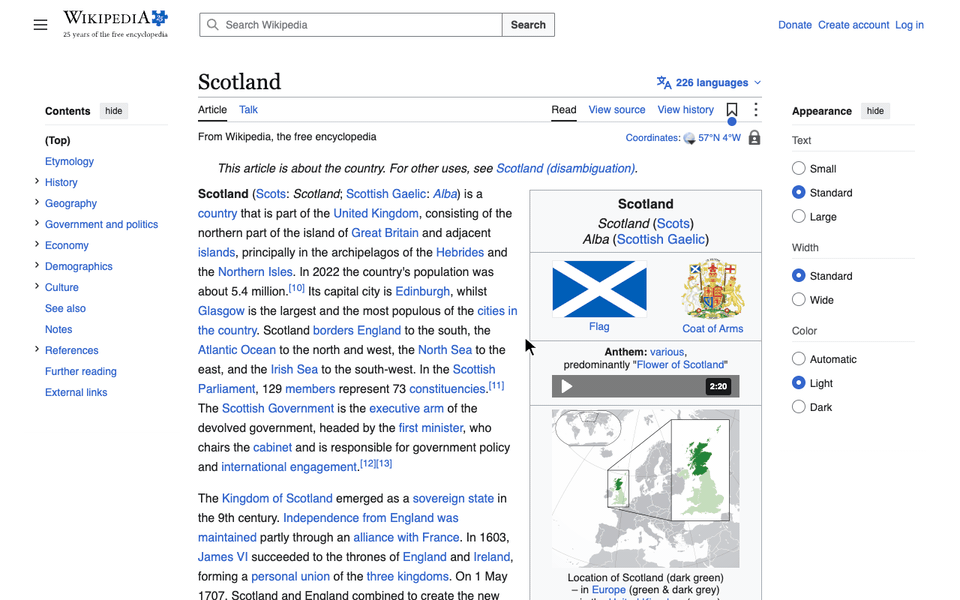
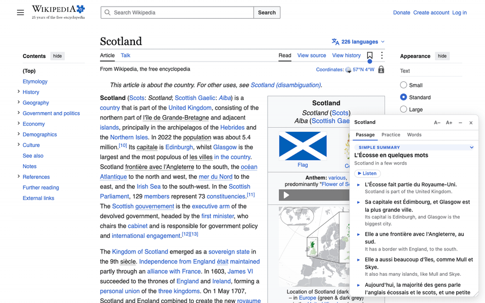
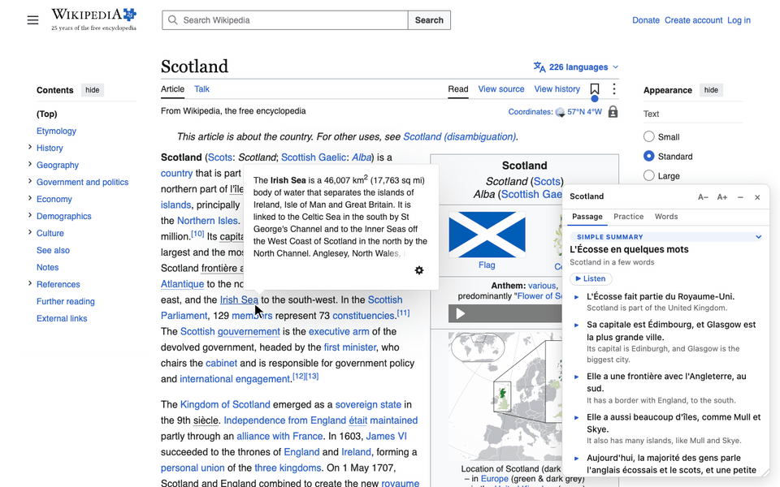

# Language Weave

Learn a language while you browse the web. Language Weave is a Chrome extension that swaps words in English for the language you're learning, picked to fit your level. A collapsible widget writes short summaries about what you're reading to your level and gives you mini exercises on them, with audio.



It supports 14 languages: Arabic, Brazilian Portuguese, Czech, French, German, Hebrew, Hindi, Italian, Japanese, Korean, Mandarin Chinese, Russian, Scottish Gaelic (no audio) and Spanish.

## What it does

The popup has two modes:

- **This page** (the default). The floating widget writes a short passage about the part of the page you're reading. It uses words from the page and grammar for your level, and moves along with you as you scroll. Its **Practice** tab gives you exercises on the same section.
- **Lesson**. A course from A1 to B1 (beginner to intermediate), about 25 lessons per language. Each lesson has a short page,and stays open as you switch tabs. It can mark the page you're on wherever the lesson applies (e.g. marking countries on a page in a lesson teaching where I am from? phrases). You can also write your own lessons: give a topic and a level, and it builds the lesson for you.



Along the way it keeps track of your words: the ones you've seen, ☆ saved or ✓ marked known. The **Words** page lists them, and **Progress** shows how practice is going.

## Install

### 1. Add the extension to Chrome

The extension isn't in the Chrome Web Store, so you load it yourself. This takes about a minute:

1. Download `language-weave-<version>-chrome.zip` from the [latest release](https://github.com/sbirbrower/language-weave/releases/latest) and unzip it.
2. In Chrome, go to `chrome://extensions`.
3. Turn on **Developer mode** (top right).
4. Click **Load unpacked** and choose the unzipped folder.
5. Pin Language Weave to the toolbar: click the puzzle-piece icon, then the pin next to it.

Keep the folder: Chrome runs the extension from it. To update, download the new zip, replace the folder's contents, and click ↻ on Language Weave in `chrome://extensions`.

### 2. Get a API key

Language Weave by default calls claude with your own key, and you pay Anthropic directly for what you use.

1. Sign up at [console.anthropic.com](https://console.anthropic.com).
2. Add some credit under **Billing**. A few dollars lasts weeks (see [Cost](#cost)).
3. Under **API keys**, create a key and copy it. It starts with `sk-ant-`.

### 3. Add your key

Click the Language Weave icon, then **Options**. Paste the key into **Anthropic API key** and click **Save**.

You can add these optional keys too:

| Key | What it adds |
|---|---|
| Google Cloud Text-to-Speech | 🔊 audio on words, passages and listening exercises. Without it, there's no audio. |
| DeepInfra | Speaking exercises, where you say a sentence and it checks your pronunciation. Also switch on **Speaking exercises** in Options. |
| TypeSafe | Faster, more accurate checks for lesson mode's marks on the page. Fractions of a cent for hundreds of calls. |

You can use OpenAI or Google Gemini instead of Anthropic: choose them under **Provider**. 

## Using it

1. Open any website.
2. Click the Language Weave icon.
3. Click **Weave this page**, or press **Alt+Shift+W**.

Words change into your language, and the window opens beside the page. Some things to try:

- **Point at a woven word** for buttons: 🔊 says it, ☆ saves it, ✓ marks it known. Click the word itself to see the English.

  

- **Scroll** and the passage follows the section you're reading.
- **Highlight some text** to have the passage written about that instead.
- **Practice** gives you exercises one at a time. **More like this** gives you another of the same kind.
- **Restore English** in the popup puts the page back.

Uncheck **Weave the page** in the popup to keep the page in English and use only the practice weidget.

For lessons, switch the popup to **Lesson**, pick one from the list and click **Open the lesson**. **New lesson…** at the end of the list is where you write your own.

## Cost

The popup shows what each page has cost so far. By default, the weave uses Claude Haiku (the cheapest model). Passages and exercises use Claude Sonnet with extended thinking off. A passage costs well under a cent. Heavy usuage tends to be about 30¢/day. Writing your own lesson uses Claude Opus and costs about 4¢. You can change the models in Options.

## Privacy

- Your keys are kept in Chrome on your computer (`chrome.storage.local`), are never synced, and are never logged.
- When you weave a page or open the window, the text of that page is sent to the AI provider you chose, using your key. Nothing is sent from pages you don't use it on.
- Chrome will warn that the extension can "read and change all your data on all websites". It needs this to work on any page you choose, and so an open lesson can follow you from tab to tab.
- Speaking exercises are off unless you turn them on. Nothing is recorded until you press **Record**, and the clip goes to DeepInfra to be written down.

## Troubleshooting


- **It says the key is missing or wrong.** Check it in Options, and check that your Anthropic account has credit.
- **No 🔊 buttons.** Audio needs the Google Cloud Text-to-Speech key. Scottish Gaelic has no Google voice, so it has no audio.

## Building from source

You need Node (developed on Node 26) and Chrome.

```sh
npm install
npm run build     # builds into .output/chrome-mv3/: load that folder unpacked
npm run zip       # the zip for a release
npm test          # Vitest + jsdom
npm run compile   # type-check
```

After a rebuild, click ↻ on Language Weave in `chrome://extensions`.

It's built with WXT and TypeScript (Manifest V3). `entrypoints/` holds the background worker (the only place that calls a model), the content script, popup, options and other pages. `src/` holds the logic as pure functions with tests: the weave pipeline (`src/weave/`), passages (`src/passage/`), practice (`src/practice/`), and one config, syllabus and grammar file per language (`src/languages/`, `src/syllabus/`, `src/grammar/`). `docs/` has one page per area, starting with `docs/architecture.md`.

## Status

This is a personal project.

## License

MIT. See [LICENSE](LICENSE).
